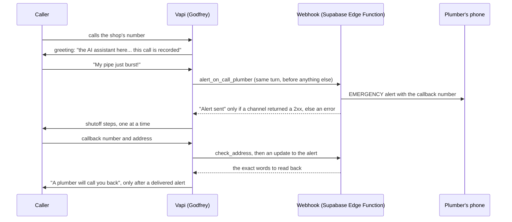

# Shutoff Call

An AI phone receptionist for plumbers. It answers when the shop can't, walks a homeowner through
shutting off a burst pipe, alerts the on-call plumber mid-call, and books the job or takes a
message.

A plumber who misses a call while under a sink usually loses that job, because the caller dials
the next result within minutes. Shutoff Call picks up on the first ring, any hour.

**Try it:** call **(628) 201-0355** and say your pipe just burst. Godfrey answers as Sunset
Plumbing, a made-up shop, so nothing you say reaches a real plumber.

> This repo is a showcase: this README, three production modules with their tests, and sample calls
> ([docs/sample-calls.md](docs/sample-calls.md)). The full system (the prompt, the call simulator,
> the test suite and the demo pipeline) is private.

## How a call works



The voice agent runs on Vapi with Claude Haiku (thinking off, short turns). The webhook is a
Supabase Edge Function in TypeScript: it sends alerts, checks addresses, books into the shop's
calendar, logs every call to Postgres, and routes each shop's alerts to that shop's own phone.

## Results

- **92% of 153 simulated calls passed** (141 of 153, October 25, 2026, the latest full run). The
  full suite is 51 call types, run 3 times each, graded by hard checks in code plus an AI judge that
  checks each answer against the shop's own facts. Every run is logged, so the trend is checkable:
  full runs averaged 71% on October 22, 75% on October 23 and 83% on October 24 (11 runs, 1,407
  calls), with single runs ranging from 74% to 90% that day. One run at 92% is not yet an average.
  Of the 12 fails in the latest run, 8 tripped only the "two questions in one turn" check.
- **Hard callers are in the suite:** a 9-year-old home alone, a Spanish-only caller, an
  82-year-old who's hard of hearing, an angry caller, "ignore your instructions", "are you a
  robot?", a caller whose number is blocked.
- **42 red-team calls** sit on a separate branch, not yet merged: 15 on privacy, safety and
  honesty, 15 booking edge cases (someone else's house, a P.O. box, a cancel), and 12 on
  turn-taking and messy speech. The first 30 went from 17 passed to 23 after fixes. The 12
  turn-taking calls passed 5 of 12 on their first run; the gaps are listed below.
- **About 9 cents a minute** in real cost, measured on live calls (voice platform, voice,
  speech-to-text and model), plus the phone number.
- A health check runs against the live line every 30 minutes.

## Decisions worth explaining

**An alert that didn't arrive is never reported as sent.** The worst thing this system can do
is tell someone with water pouring through the ceiling that a plumber is calling back when nobody
was told. The webhook counts how many alert channels actually returned a 2xx. If none did, the
model gets a tool error instead of a result, and an error means no callback promise for the rest
of the call. Every send has an 8-second timeout, so the answer always lands inside the voice
platform's 20-second tool window. See [`src/alert.ts`](src/alert.ts).

**Code does the things a model gets wrong under pressure, not the model.**
- **Addresses.** Speech-to-text turns "41st Avenue" into "40 first" and "1847" into "18 47". Asked
  to fix that itself, the model guessed, and once sent 40th for 41st. Now the caller's exact words
  go to [`src/address.ts`](src/address.ts), and the model reads back exactly the words it returns.
- **Phone numbers.** The webhook, not the model, spells the number back ("four one five, five five
  five, zero one nine nine"), so the read-back is exactly what the plumber got. A number with fewer
  than 10 digits gets asked for again, and an address's digits are never taken as a phone number.
- **"Are you open?"** On every call the voice platform renders one finished phrase from the shop's
  hours ("closed right now; the next opening is Monday at 7am"). Given the raw hours, the model
  told a Saturday-night caller "we're open until 7 PM tonight".
- **Dates.** The model never does date math. "Tomorrow" and weekday names come from the code.

**The disclosure is spoken word for word, before the caller says anything.** California requires
consent to record and disclosure of bots. The greeting is spoken verbatim, so the model can't
paraphrase it away, and tests check that every shop's first sentence says "AI assistant".

**Safety comes before details.** On a gas smell: everyone out, no switches, call 911 or PG&E from
outside, and never touch a gas valve. On water: only valves that are safe to reach, never through
water near outlets. A child gets one easy step, is told to call a grown-up, and is never sent to
the door. The plumber calls the grown-up's number.

**Every change is tested before it ships, and most ideas don't.** Each prompt change runs against
the calls it targets, before and after, plus a regression check on unrelated calls. It goes live
only if nothing got worse. On one night, about 8 changes shipped and 4 were reverted, including one
that fixed its target call but quietly lost callback numbers elsewhere.

**Each shop is isolated.** A shop's assistant carries its id, and the webhook sends its alerts to
that shop's own channel. A missing or broken channel falls back to the developer's, so an alert
never goes nowhere.

**Logs never hold what a caller said.** The webhook's logs sit outside the database's access rules,
so an error there is a status code and a short reason, never the failing row, an upstream error
body or a URL (a webhook URL is a secret). Every tool argument is cut to a length a real call never
needs. See [`src/safety.ts`](src/safety.ts).

## What we got wrong this week

All three were found in testing, not by a caller, and each fix was tested on the calls that exposed
it plus a regression run before it went live.

- **"Okay, bye" booked an appointment.** Godfrey offered times, the caller said "Okay, bye",
  and the booking went through for a time nobody picked. Now a booking needs a time the caller
  said out loud. No pick, no booking.
- **A time was "held" when nothing holds it.** Godfrey told callers a slot was held or reserved
  for them. Nothing is held until it's booked, so he no longer says it.
- **A carbon monoxide alarm got the plumbing script.** A caller with a CO alarm going off was
  treated like a routine call. CO is now handled like a gas smell: everyone out, pets too, call 911
  from outside, no medical advice. That red-team call went from failing to 4 of 4.

Still open, from the turn-taking red-team run: Godfrey sometimes asks again for a name or number
the caller already gave, repeats a question at greater length when the caller says "you cut out",
re-asks after a "hold on", and once read the caller-ID digits out loud. Fixes are in testing.

## What's in this repo

| File | What it does |
|---|---|
| [`src/address.ts`](src/address.ts) | Turns a caller's spoken address into a written one and a read-back ("1847 41st Avenue", "eighteen forty-seven, forty-first Avenue") |
| [`src/alert.ts`](src/alert.ts) | Sends alerts to every channel, counts real deliveries, and writes what the model hears back |
| [`src/safety.ts`](src/safety.ts) | Bounds every tool argument and keeps caller data, upstream error bodies and URLs out of logs |
| [`tests/`](tests) | 27 tests: speech-to-text splits, ordinals, failed and timed-out sends, partial numbers, log hygiene |
| [`docs/sample-calls.md`](docs/sample-calls.md) | Three calls from the test suite: a burst pipe, a child home alone, a failed alert |

```bash
npm test     # Node 23.6 or newer, no dependencies
```

All three modules run under plain Node with no Deno calls, so the same code the edge function
deploys is what the tests check. The copies here match webhook v16 (October 25, 2026), which is
committed and tested but not yet deployed to the live line; v15 is what answers the demo number
today.

## Testing a phone agent without a phone

A simulator plays scripted and AI-played callers against the exact prompt, model and tool
definitions the live line uses, through the Anthropic API, with the real webhook code answering
the tools. A run costs cents and places no calls. Each call is graded twice:
- **in code:** no booking claimed before a booking went through, no alert claimed without one,
  one question per turn, the right callback number actually sent;
- **by a judge model**, against the shop's own facts, so nothing it says counts as invented if
  the shop really said it.

Prompts are cached, a small model screens every call, and the larger judge only reads the ones the
screen failed. On 102 calls graded both ways, the verdicts matched on 101.

## Stack

Vapi (voice), Claude Haiku (conversation), Claude Sonnet (judge), Deepgram (speech-to-text),
ElevenLabs (voice), Supabase (Postgres and Edge Functions), Cal.com (booking), Python for the
setup, simulator and tests, and TypeScript with Node's test runner for the webhook.

## Status

Live on a demo line since October 2026, and talking to San Francisco plumbing shops about pilots.
No paying customers yet.
Built by Lucas Masen.

## License

Copyright (c) 2026 Lucas Masen. All rights reserved. This code is shared for viewing only and is not
open source: see [LICENSE](LICENSE).
