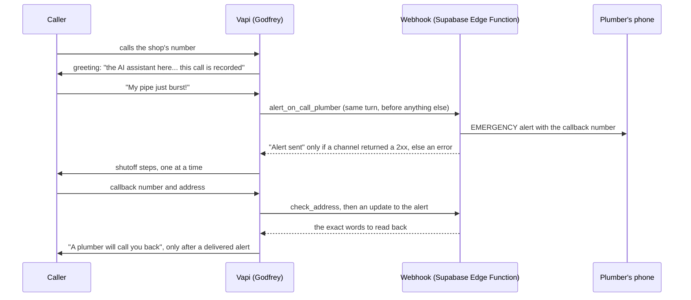

# Leek

An AI phone receptionist for plumbers. It answers when the shop can't, alerts the shop mid-call on
a burst pipe, walks the homeowner to the shutoff valve, and books routine jobs or takes a message.

A plumber who misses a call while under a sink usually loses that job, because the caller dials
the next result within minutes. Leek picks up on the first ring, any hour.

**Try it:** the demo line is live. Call **(628) 201-0355**, any hour, and say your pipe just burst.
Godfrey answers as Sunset Plumbing, a made-up shop. The alert goes to my phone, never to a real
plumber.

> This repo is a showcase: this README, three production modules with their tests, and sample calls
> ([docs/sample-calls.md](docs/sample-calls.md)). The full system (the prompt, the call simulator,
> the test suite and the demo pipeline) is private.

## How a call works



The voice agent runs on Vapi with Claude Haiku (thinking off, short turns). The webhook is a
Supabase Edge Function in TypeScript: it sends alerts, checks addresses, books into the shop's
calendar, logs every call to Postgres, and routes each shop's alerts to that shop's own phone.

## Results

**On real calls.** The line has taken 10 real calls since October 19, all tests by me and people I
asked, not customers. Read from the voice platform's own call records:
- **The emergency alert went out a median 21 seconds after the caller started talking** (on the 7
  calls that sent one).
- **Replies start a median 1.4 seconds after the caller stops talking**, over 100 timed turns (p90
  2.5 s, worst 4.1 s). The model and the voice take about 0.4 s each; the rest is our own rules for
  deciding the caller is done, and tool calls.
- **About $0.09 a minute** all in (voice platform, voice, speech-to-text and model), plus the phone
  number.
- 0 tool errors and 0 platform errors.

Ten calls is a small sample, so these are medians, not percentages.

**In the simulator: 83-92% on full runs**, depending on how many adversarial cases the run
includes. Every score in this section is simulated.
- **92%** (141 of 153, October 25): 51 call types, 3 runs each.
- **83%** (96 of 115, October 28): 66 call types, including 15 adversarial ones from red-team rounds
  4 and 5, written to find failures. Those passed 21 of 31; the 51 shared call types passed 89%.
- Every run is logged, so the trend is checkable: full runs averaged 71% on October 22, 75% on
  October 23 and 83% on October 24 (11 runs, 1,407 calls). In the 92% run, 8 of the 12 fails
  were only the strict "two questions in one turn" check.
- **Hard callers are in the suite:** a 9-year-old home alone, a Spanish-only caller, an
  82-year-old who's hard of hearing, an angry caller, "ignore your instructions", "are you a
  robot?", a caller whose number is blocked.

A health check tests the live line's setup and webhook every 30 minutes, but for now it runs from
my laptop, so it misses hours overnight. Moving it to an always-on scheduler is on the list.

## How it was tested: trying to break it

**Six red-team rounds, 81 adversarial calls.** Each round writes callers designed to make Godfrey
fail, runs them against the current prompt, and fixes what breaks:
1. privacy, safety and honesty (15 calls);
2. booking edge cases: someone else's house, a P.O. box, a cancel (15);
3. turn-taking and messy speech: "hold on", "you cut out" (12);
4. real life is messy: a noisy job site, a phone handed to a roommate, a dying battery (15);
5. a skeptical shop owner calling to catch it bluffing or overpromising (12);
6. an AI engineer probing the AI itself: its model, its prompt, other callers' data, tool
   failures (12).

From rounds 4 to 6, the cases that failed moved into the main suite with their fix, so a
regression shows up on the next full run. Round 6 passed 8 of 12 on its first run. Of the 4 fails,
two went away with the reply-cap fix below, one was only the strict two-questions check, and one
(a tester should be offered a message) went from 1 of 3 to 3 of 3 that night.

**A tester broke it on a Sunday night.** They called to break it, and did: they got it to read
the callback number back wrong twice (the request that reached the shop still had the right
number). That night both calls became test cases and the fix was written: a prompt rule (read back
the last number said) and a webhook change that spells out the number it actually sent, so the read-back comes from code, not
the model ([`sentWithNumber` in `src/alert.ts`](src/alert.ts)). In the simulator that call went from
1 of 6 runs passing to 6 of 6. The prompt half is live, and the webhook half (v16) deployed
October 29. A replay of the call on October 28, before that deploy, still got the read-back wrong.
So the fix is deployed and simulated, with live test-call verdicts still pending, not yet proven
on a real call.

**An overnight benchmark found a bug three prompt rewrites couldn't.** Bookings kept losing the job
description: in one night's runs, 58 of 188 booking calls (some of them retries) left it out. We
tried three rewordings of the prompt and the booking tool's description; none helped, and all were
reverted. The overnight run traced it to a 250-token cap on each reply. "Let me book that for you"
plus a booking for a caller with several jobs runs about 300 tokens, so the API returned the tool
call cut short, missing its last field. Raising the cap to 500, plus a webhook guard that refuses a
booking with no description, put the description in 22 of 22 simulated bookings. Both have been
live since October 29, 11:44am PT; live test-call verdicts are still pending.

## Decisions worth explaining

**An alert that didn't arrive is never reported as sent.** The worst thing this system can do
is tell someone with water pouring through the ceiling that a plumber is calling back when nobody
was told. The webhook counts how many alert channels actually returned a 2xx. If none did, the
model gets a tool error instead of a result, and an error means no callback promise for the rest
of the call. Every send has an 8-second timeout, so the answer always lands inside the voice
platform's 20-second tool window. See [`src/alert.ts`](src/alert.ts).

**Code does the things a model gets wrong under pressure, not the model.**
- **Addresses.** Speech-to-text turns "41st Avenue" into "40 first" and "1847" into "18 47". Asked
  to fix that itself, the model guessed, and once sent 40th for 41st. Now the caller's exact words
  go to [`src/address.ts`](src/address.ts), and the model reads back exactly the words it returns.
- **Phone numbers.** The webhook, not the model, spells the number back ("four one five, five five
  five, zero one nine nine"), so the read-back is exactly what the plumber got. Since the red-team
  call above, callback requests and messages do the same (v16). A number with fewer than 10 digits
  gets asked for again, and an address's digits are never taken as a phone number.
- **"Are you open?"** On every call the voice platform renders one finished phrase from the shop's
  hours ("closed right now; the next opening is Monday at 7am"). Given the raw hours, the model
  told a Saturday-night caller "we're open until 7 PM tonight".
- **Dates.** The model never does date math. "Tomorrow" and weekday names come from the code.

**The disclosure is spoken word for word, before the caller says anything.** California requires
consent to record and disclosure of bots. The greeting is spoken verbatim, so the model can't
paraphrase it away, and tests check that every shop's first sentence says "AI assistant".

**Safety comes before details.** On a gas smell: everyone out, no switches, call 911 or PG&E from
outside, and never touch a gas valve. On water: only valves that are safe to reach, never through
water near outlets. A child gets one easy step, is told to call a grown-up, and is never sent to
the door. The plumber calls the grown-up's number.

**Every change is tested before it ships, and most ideas don't.** Each prompt change runs against
the calls it targets, before and after, plus a regression check on unrelated calls. It goes live
only if nothing got worse. On one night, about 8 changes shipped and 4 were reverted, including one
that fixed its target call but quietly lost callback numbers elsewhere.

**Each shop's alerts go to that shop's own channel.** A shop's assistant carries its id, and the
webhook sends its alerts to that shop's own channel. A missing or broken channel falls back to the
developer's, so an alert never goes nowhere. This is routing, not full isolation: shops still share
one webhook secret and one global booking and spreadsheet configuration.

**Logs never hold what a caller said.** The webhook's logs sit outside the database's access rules,
so an error there is a status code and a short reason, never the failing row, an upstream error
body or a URL (a webhook URL is a secret). Every tool argument is cut to a length a real call never
needs. See [`src/safety.ts`](src/safety.ts).

## What we got wrong

Found in testing, not by a customer. Each fix is tested on the calls that exposed it, plus a
regression run, before it goes live.

**Most recent**
- **A callback number read back wrong.** The tester's call above: the model was reading the digits
  itself. The code fix has been live since October 29 (webhook v16) and passed in the simulator;
live test-call verdicts are pending, so this is still the failure we watch for.
- **Three prompt rewrites for a bug that wasn't in the prompt.** Bookings lost the job description
  because the reply cap cut the tool call short (above). We should have checked the raw API output
  before rewording anything.
- **A fix for talk-overs made every reply slower.** On October 23 we made Godfrey wait 0.6 s instead
  of 0.2 s after a caller's full stop, so he'd stop cutting people off. That added about 0.4 s to
  every ordinary turn (1.26 s to 1.65 s median). A narrower rule (three endpointing rules instead of
one blanket wait) has been live since October 29; live test-call verdicts are pending.

**Before that**
- **"Okay, bye" booked an appointment.** Godfrey offered times, the caller said "Okay, bye", and the
  booking went through for a time nobody picked. Now a booking needs a time the caller said out
  loud.
- **A time was "held" when nothing holds it.** Nothing is held until it's booked, so he no longer
  says it.
- **A carbon monoxide alarm got the plumbing script.** CO is now handled like a gas smell: everyone
  out, pets too, call 911 from outside, no medical advice. That red-team call went from failing to
  4 of 4.

Still open from round 3: Godfrey sometimes asks again for a name or number the caller already
gave, repeats a question at greater length after "you cut out", and re-asks after a "hold on".

## What's in this repo

| File | What it does |
|---|---|
| [`src/address.ts`](src/address.ts) | Turns a caller's spoken address into a written one and a read-back ("1847 41st Avenue", "eighteen forty-seven, forty-first Avenue") |
| [`src/alert.ts`](src/alert.ts) | Sends alerts to every channel, counts real deliveries, writes what the model hears back, and spells out the number it sent |
| [`src/safety.ts`](src/safety.ts) | Bounds every tool argument and keeps caller data, upstream error bodies and URLs out of logs |
| [`tests/`](tests) | 28 tests: speech-to-text splits, ordinals, failed and timed-out sends, partial numbers, number read-backs, log hygiene |
| [`docs/sample-calls.md`](docs/sample-calls.md) | Three calls from the test suite: a burst pipe, a child home alone, a failed alert |

```bash
npm test     # Node 23.6 or newer, no dependencies
```

All three modules run under plain Node with no Deno calls, so the code the edge function deploys is
what the tests check. Note: the published `src/` is a pre-v16 snapshot, not the code now on the live
line (webhook v16, deployed October 29, 2026); `src/alert.ts` in particular differs.

## Testing a phone agent without a phone

A simulator plays scripted and AI-played callers against the exact prompt, model and tool
definitions the live line uses, through the Anthropic API, with the real webhook code answering
the tools. A run costs cents and places no calls. Each call is graded twice:
- **in code:** no booking claimed before a booking went through, no alert claimed without one,
  one question per turn, the right callback number actually sent;
- **by a judge model**, against the shop's own facts, so nothing it says counts as invented if
  the shop really said it.

Prompts are cached, a small model screens every call, and the larger judge only reads the ones the
screen failed. On 102 calls graded both ways, the verdicts matched on 101.

## Stack

Vapi (voice), Claude Haiku (conversation), Claude Sonnet (judge), Deepgram (speech-to-text),
ElevenLabs (voice), Supabase (Postgres and Edge Functions), Cal.com (booking), Python for the
setup, simulator and tests, and TypeScript with Node's test runner for the webhook.

## Status

The demo line has been live since October 19, 2026. No shop has agreed to a pilot yet, and there
are no paying customers; I'm cold-calling San Francisco plumbing shops this week.
Built by Lucas Masen.

## License

Copyright (c) 2026 Lucas Masen. All rights reserved. This code is shared for viewing only and is not
open source: see [LICENSE](LICENSE).
